<p align="center">
  
</p>

<h3 align="center">Tutti i tuoi giochi, in tasca.</h3>

<p align="center">
  Un sistema di gioco per <b>TrimUI Smart Pro</b> e <b>Brick Pro</b>: arcade, console e giochi Linux.<br>
  Parte dalla microSD e non tocca la memoria interna della console.
</p>

<p align="center">
  <a href="https://github.com/diapolon/mosaik_cfw/releases">Scarica</a> ·
  <a href="#installazione">Installazione</a> ·
  <a href="#caricare-i-giochi">Caricare i giochi</a> ·
  <a href="#comandi">Comandi</a> ·
  <a href="#problemi-frequenti">Problemi frequenti</a> ·
  <a href="https://github.com/diapolon/mosaik_cfw/wiki/Italiano">Wiki</a> ·
  <a href="#sostieni-mosaik">Sostieni</a> ·
  <a href="README.md">English</a>
</p>

<p align="center">
  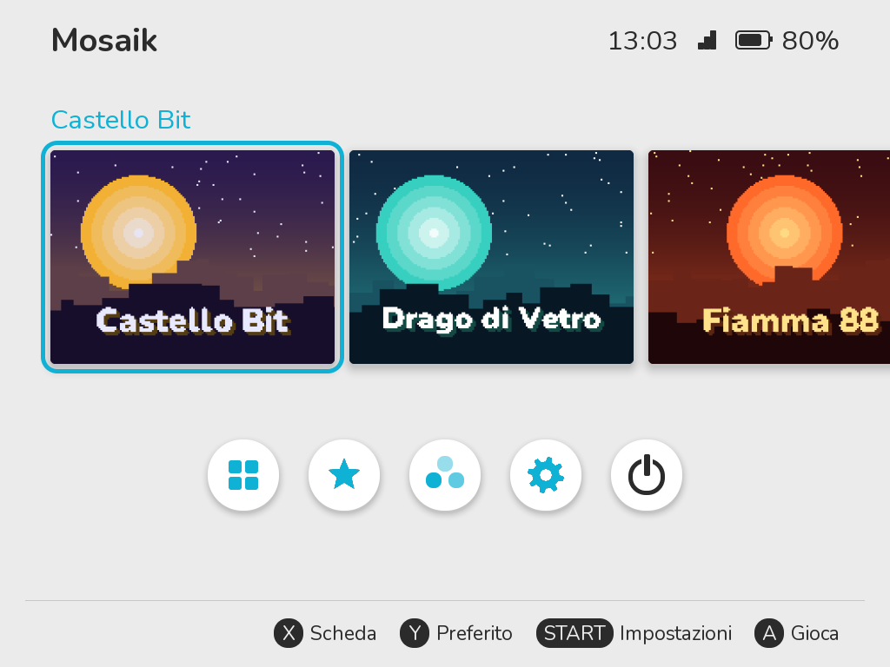
</p>

> **Stato:** versione 0.9. **Smart Pro e Brick Pro: provate.**

## Cosa c'è dentro

- **Emulatori dallo Store**: il sistema resta piccolo e installi solo quello che usi, dallo **Store** nella home. Ogni pacchetto è firmato; **Archivia** toglie un emulatore e tiene giochi e salvataggi, **Elimina** toglie tutto dopo averti mostrato cosa se ne va.
- **FinalBurn Neo, MAME 2003-Plus e MAME 2010**: Neo Geo, CPS1, CPS2 e gran parte dei classici arcade.
- **NES, Super Nintendo, Mega Drive, Master System, Game Gear, PC Engine, Game Boy, Game Boy Color, Game Boy Advance e Neo Geo Pocket**, con i salvataggi a batteria scritti ogni 10 secondi (anche l'orologio dei Pokémon), salvataggi separati per ogni console e le ROM zippate.
- **PlayStation** (PCSX ReARMed) con le levette del DualShock: dischi `.chd`, `.cue` e `.pbp`, giochi su più dischi con un file `.m3u` e il cambio disco nel menu di gioco.
- **Dreamcast** con [Deadcast](https://github.com/tyrannotorus/emulator-dreamcast-deadcast), per ora soprattutto sulla Brick Pro.
- **Copertine e informazioni anche per le console**: scatola, titolo, anno, editore, genere e giocatori, trovati dalla ROM stessa.
- **Giochi Linux**, con menu sopra al gioco e sospensione.
- **Avvio in circa 5 secondi**, sospensione con il tasto di accensione.
- **Wi-Fi integrato** per copertine, storia dei giochi, ora e aggiornamenti.
- **Trasferimento file via Wi-Fi** da computer o telefono: inquadri il QR o apri `mosaik.local`, poi carichi ROM e scarichi salvataggi senza togliere la scheda.
- **Backup e ripristino**: un solo zip con salvataggi, impostazioni, BIOS e, se vuoi, i giochi; lo ripristini tutto o solo le parti che scegli, anche su una scheda nuova o sull'altro modello.
- **App**: i programmi che non sono giochi hanno una sezione loro nella home.
- **Tre temi con varianti di colore**, lingue, LED e filtri video configurabili.
- **Aggiornamenti firmati** via Wi-Fi, tutto o niente: se uno si interrompe o la versione nuova non parte, la console torna a tutti i file di prima.
- **Profilo CPU per ogni gioco** e avviso nella home quando c'è un aggiornamento.
- **Diagnosi dei giochi**: quando un gioco non parte, ti dice cosa manca e dove copiarlo.
- **Tre slot di salvataggio per gioco** con anteprima e data, più un salvataggio automatico con copia precedente.

## L'interfaccia

<table>
  <tr>
    <td>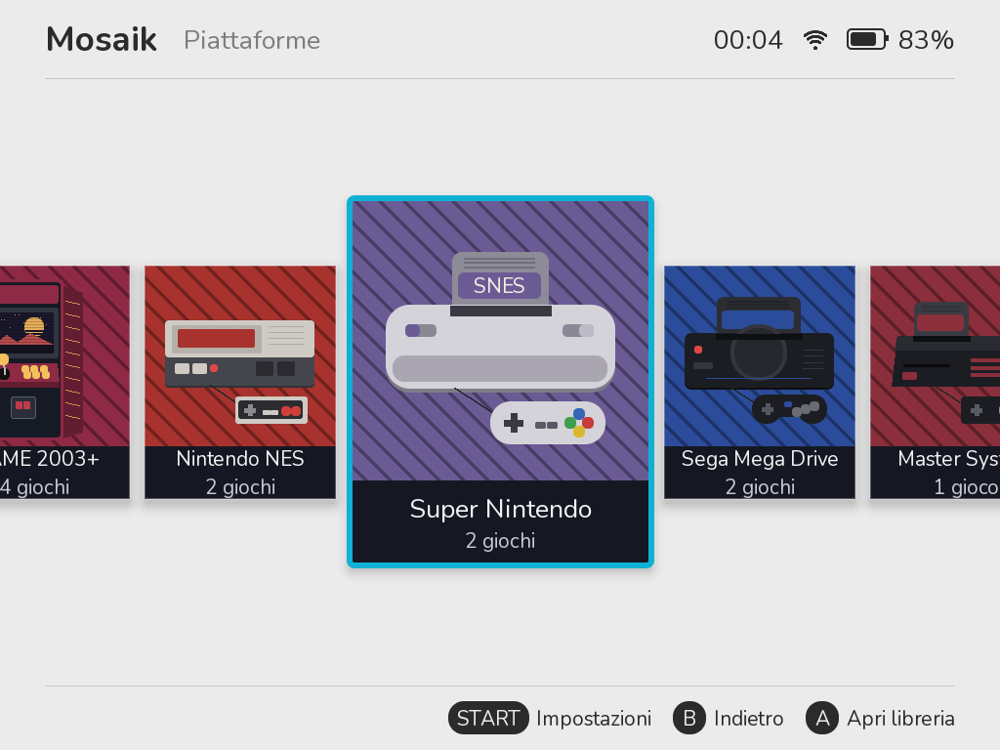</td>
    <td>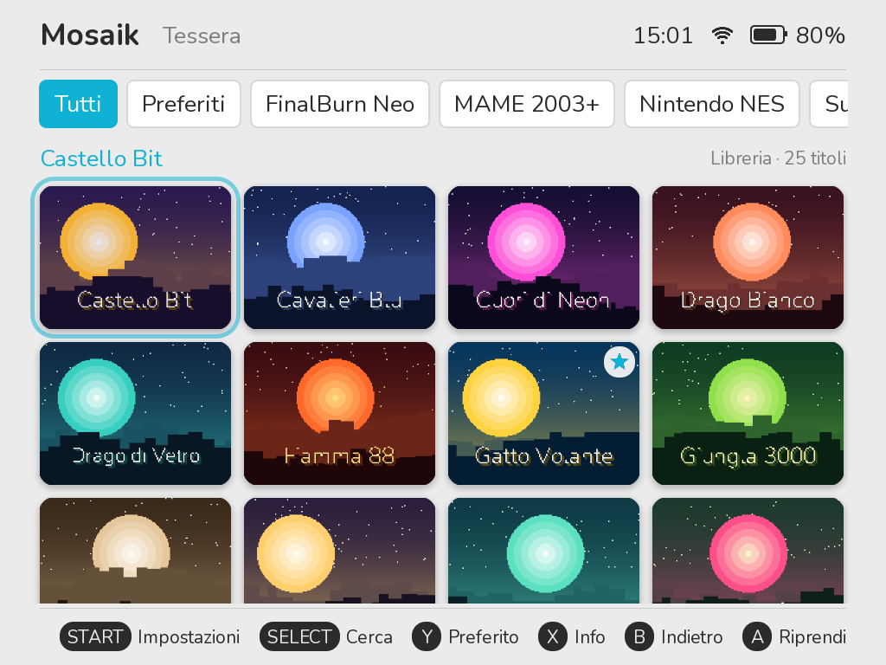</td>
  </tr>
  <tr>
    <td align="center">Le piattaforme, per scegliere la categoria prima dei giochi</td>
    <td align="center">La libreria, a griglia di immagini in Tessera</td>
  </tr>
  <tr>
    <td>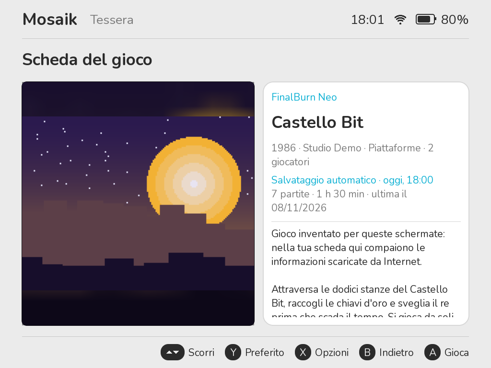</td>
    <td>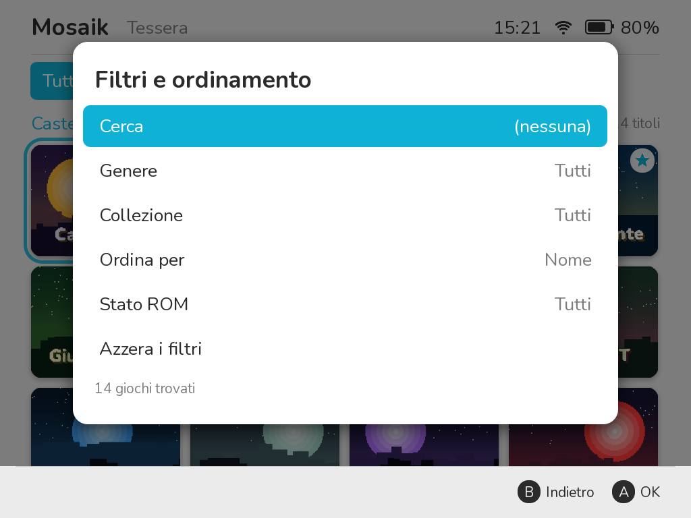</td>
  </tr>
  <tr>
    <td align="center">La scheda del gioco, con storia e informazioni</td>
    <td align="center">Ricerca, generi, collezioni e ordinamento</td>
  </tr>
  <tr>
    <td>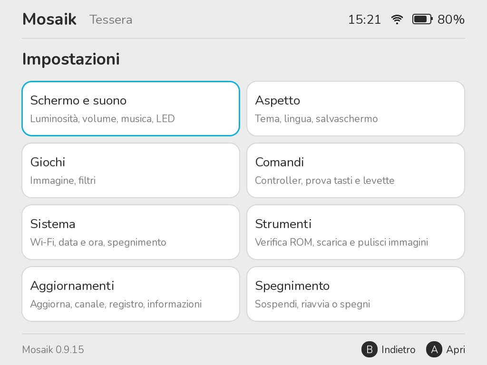</td>
    <td>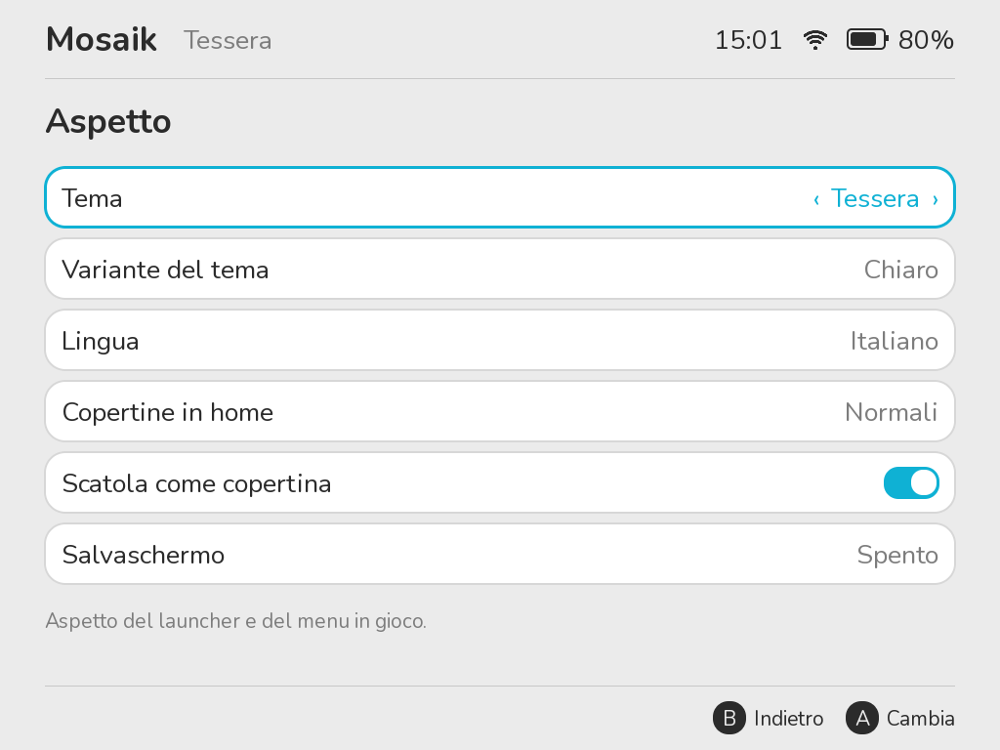</td>
  </tr>
  <tr>
    <td align="center">Le impostazioni, divise in sezioni</td>
    <td align="center">Tema, variante di colore e lingua</td>
  </tr>
  <tr>
    <td>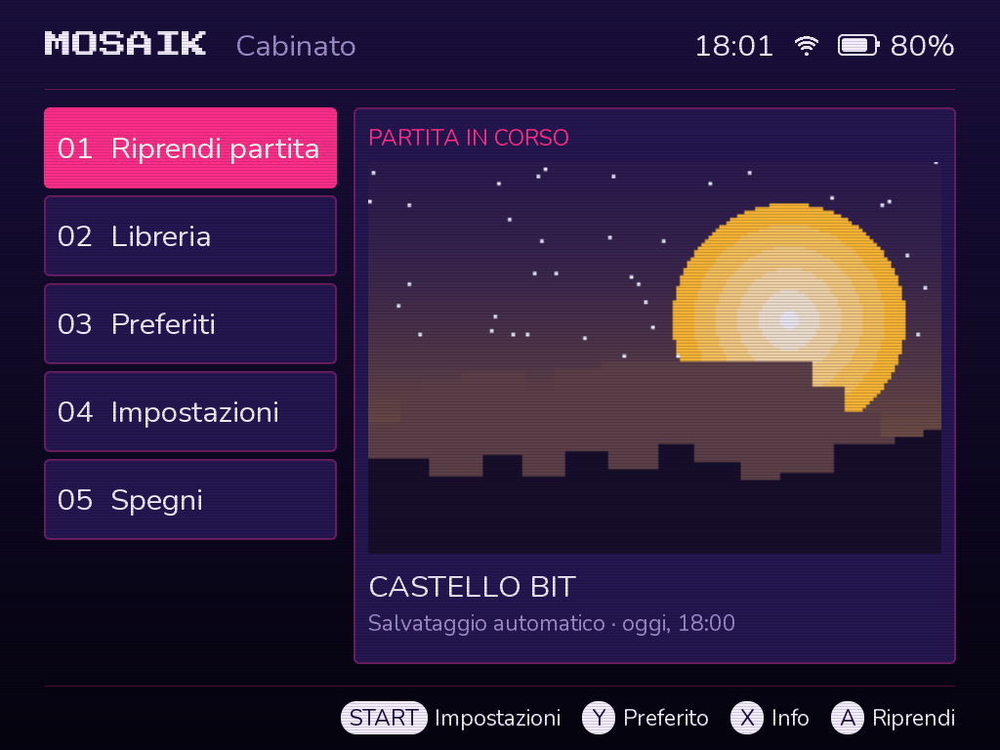</td>
    <td>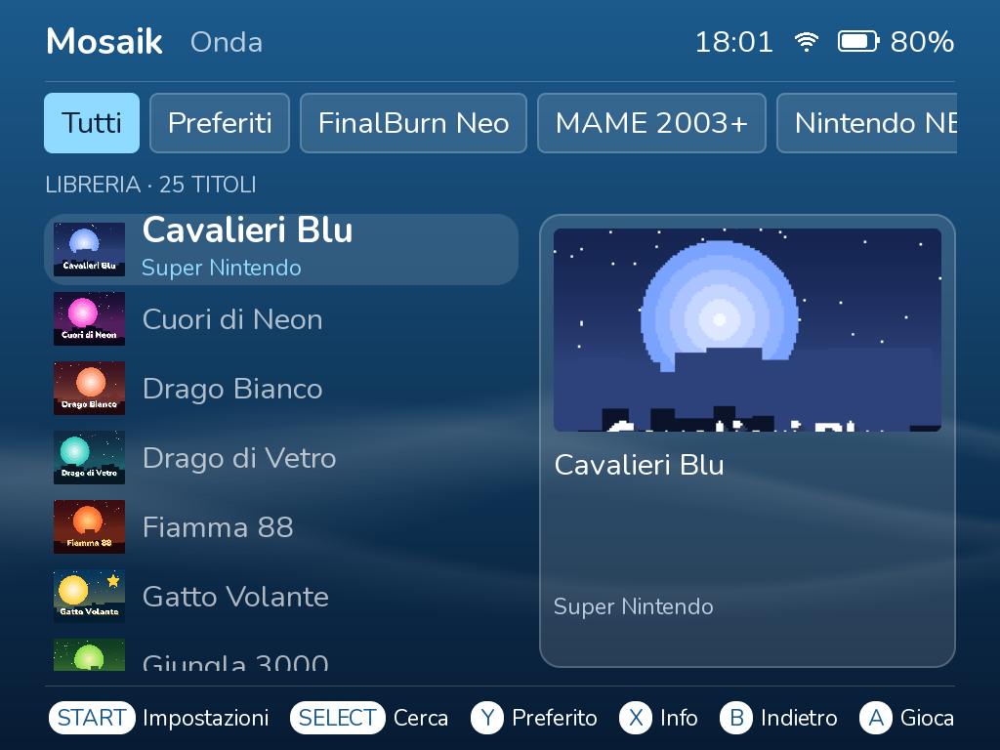</td>
  </tr>
  <tr>
    <td align="center">Tema Cabinato: il menu numerato da sala giochi</td>
    <td align="center">Tema Onda: la libreria come elenco verticale</td>
  </tr>
  <tr>
    <td>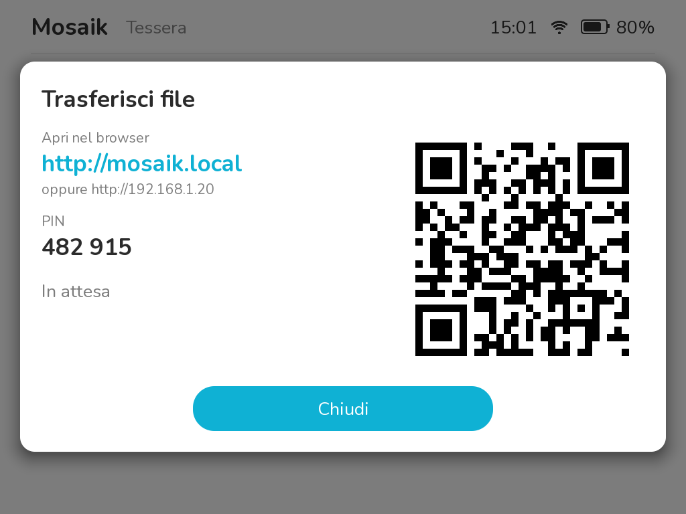</td>
    <td>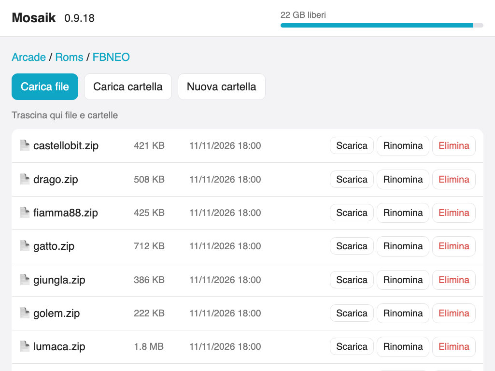</td>
  </tr>
  <tr>
    <td align="center">Trasferisci file via Wi-Fi: inquadra il QR o apri mosaik.local</td>
    <td align="center">La pagina del trasferimento, in qualsiasi browser</td>
  </tr>
  <tr>
    <td>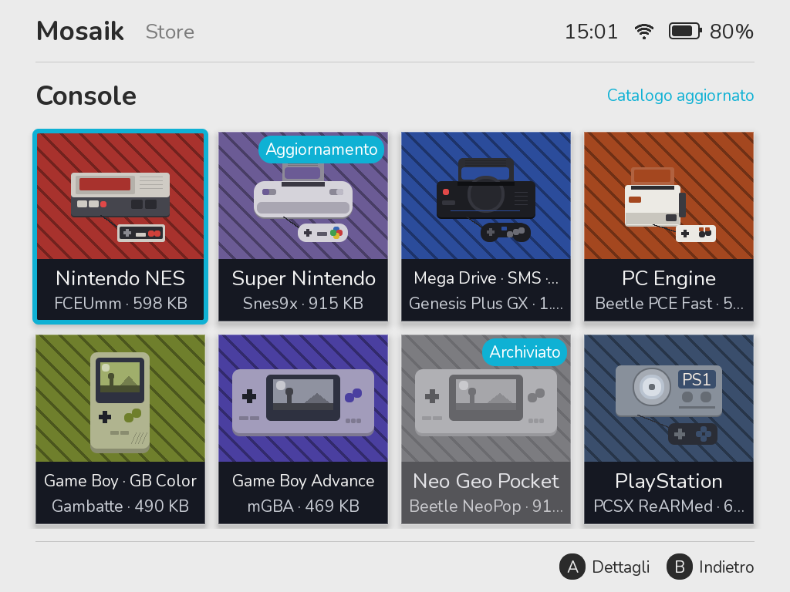</td>
    <td>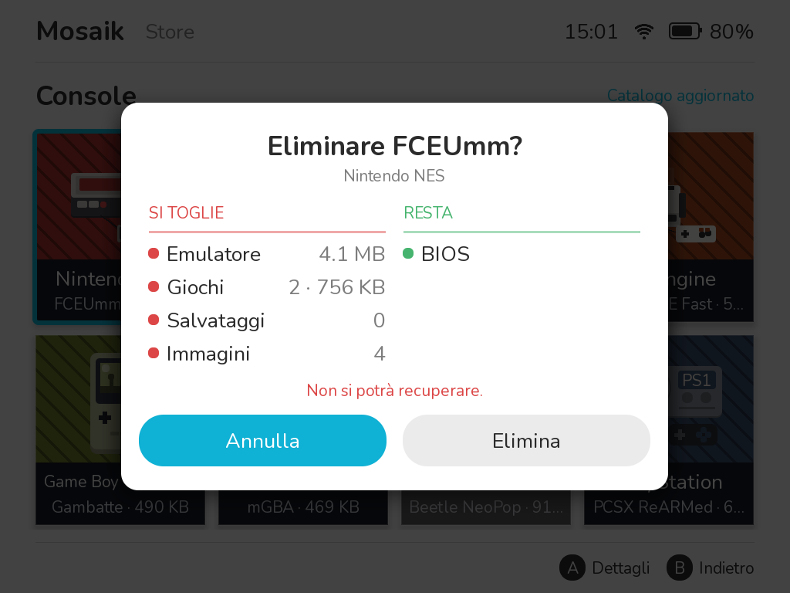</td>
  </tr>
  <tr>
    <td align="center">Lo Store: emulatori installati a colori, gli altri in grigio</td>
    <td align="center">Prima di eliminare, cosa si toglie e cosa resta</td>
  </tr>
</table>

<sub>I giochi e le copertine in queste immagini sono inventati, solo per mostrare l'interfaccia.</sub>

## Installazione

Servono una microSD di buona qualità (da 4 GB a 256 GB) e [balenaEtcher](https://etcher.balena.io/).

1. **Scarica l'immagine** del tuo modello dall'[ultima versione](https://github.com/diapolon/mosaik_cfw/releases/latest), sotto **Assets**: `mosaik-<versione>-smartpro.img.gz` per la Smart Pro, `mosaik-<versione>-brickpro.img.gz` per la Brick Pro. Non serve decomprimerla. **Controlla il nome del file: con l'immagine dell'altro modello la console non parte.** Non si rovina nulla: basta scrivere quella giusta. **Ignora tutti gli altri file** (`file-0`, `file-1`…, `update.txt`, `update.sig`, `store.json`, `store.sig`, archivi dei sorgenti): li usano da soli l'aggiornamento Wi-Fi e lo Store della console. I file `store-….zip` sono gli emulatori, per una console senza Wi-Fi (passo 5).
2. **Scrivila sulla microSD** con balenaEtcher. Tutto ciò che c'è sulla scheda viene cancellato. Se poi il computer chiede di formattare una parte della scheda, rispondi di no.
3. **Metti la scheda nella console e accendi.** Alla prima accensione la partizione si allarga a tutta la scheda, quindi l'avvio dura un po' di più.
4. **Apri le impostazioni con Start** per scegliere la lingua (Aspetto) e impostare data, ora e Wi-Fi (Sistema).
5. **Installa gli emulatori**: apri lo **Store** dalla home (su una scheda nuova te lo propone la console) e scegli quelli che ti servono. Senza Wi-Fi, copia nella cartella principale della scheda i file `store-….zip` degli emulatori che vuoi, presi dalla release: al prossimo avvio la console propone di installarli.

Per tornare al sistema originale, spegni la console e togli la scheda.

## Caricare i giochi

> **ROM e BIOS non sono inclusi.** Usa solo copie di giochi di cui hai diritto.

Spegni la console e collega la scheda al computer. Tutto si trova nella cartella `Arcade` dell'unità `MOSAIK` (`ARCADE` sulle schede installate prima della 0.9.6):

| Cartella | Cosa contiene |
|---|---|
| `Roms/FBNEO` | ROM per FinalBurn Neo (raccolta FBNeo attuale), anche in sottocartelle |
| `Roms/MAME2003P` | ROM per MAME 2003-Plus (raccolta 0.78-plus) |
| `Roms/MAME2010` | ROM per MAME 2010 (raccolta 0.139), per i giochi che gli altri due non fanno partire |
| `Roms/NES`, `Roms/SNES`, `Roms/MD` | Giochi NES, Super Nintendo e Mega Drive |
| `Roms/SMS`, `Roms/GG`, `Roms/PCE` | Giochi Master System, Game Gear e PC Engine (HuCard) |
| `Roms/GB`, `Roms/GBC`, `Roms/GBA`, `Roms/NGP` | Giochi Game Boy, Game Boy Color, Game Boy Advance e Neo Geo Pocket |
| `Roms/PS` | Giochi PlayStation: `.chd` (consigliato), `.cue` con i suoi `.bin`, oppure `.pbp` |
| `Roms/DC` | Giochi Dreamcast: `.chd` (consigliato), `.gdi` con le sue tracce, `.cdi` o `.m3u` |
| `Bios` | `neogeo.zip` e gli altri BIOS; per il Dreamcast `dc/dc_boot.bin` |
| `Linux` | Giochi Linux, uno per cartella |
| `Apps` | Programmi che non sono giochi, uno per cartella con `launch.sh` |
| `Media` | Immagini dei giochi |
| `Music` | Musica di sottofondo (MP3, OGG, FLAC, WAV) |
| `Saves` | Salvataggi |

Tieni le ROM arcade in `.zip` e non cambiare il nome. I giochi per console possono essere zippati o no, un gioco per zip; il GBA non ha bisogno del BIOS. Per un gioco PlayStation su più dischi, elenca i dischi in un file `.m3u` nella stessa cartella: in elenco compare solo il `.m3u`, e **Disco** nel menu di gioco cambia disco. Un BIOS PlayStation (`scph5501.bin`…) in `Bios` è facoltativo. **Impostazioni → ROM e immagini → Verifica ROM** controlla che ogni zip contenga i file giusti (**Completa** legge anche tutti i dati e trova i file rovinati), e la scheda del gioco (X) mostra cosa manca, compreso un BIOS. Il menu del Dreamcast è quello di Deadcast: si apre con Menu, ed è da lì che si esce sempre dal gioco, così i salvataggi della memory card vengono scritti.

Per copertine e informazioni, collega il Wi-Fi e usa **Impostazioni → ROM e immagini → Scarica immagini**.

Puoi anche copiare i file senza togliere la scheda: apri **Impostazioni → Scheda e dati → Trasferisci file**, poi inquadra il codice QR con il telefono, oppure apri **http://mosaik.local** nel browser di un computer collegato alla stessa rete Wi-Fi e scrivi il PIN (con **Ricorda questo browser** le volte dopo non serve). Dalla pagina carichi ROM, BIOS, immagini, musica e giochi Linux (file o cartelle intere, anche trascinandoli sulla pagina), scarichi salvataggi e registri (una cartella diventa uno zip), crei, rinomini ed elimini. I file del sistema si possono solo scaricare. Il trasferimento resta acceso solo finché la finestra è aperta sulla console, e il PIN cambia ogni volta. Il riquadro **Backup** della pagina scarica un solo zip con salvataggi, impostazioni, preferiti, collezioni, tempo di gioco e BIOS (a scelta reti Wi-Fi, immagini e giochi) e lo ripristina, tutto o solo le parti che spunti; uno zip di backup copiato nella cartella principale della scheda viene proposto al prossimo avvio.

### Giochi Linux

Crea una cartella in `Arcade/Linux` con il gioco, compilato per Linux ARM a 64 bit, e un file `launch.sh` che lo avvia:

```
Arcade/Linux/MioGioco/
    launch.sh      obbligatorio: avvia il gioco
    game.json      facoltativo: titolo e opzioni
    cover.png      facoltativo: copertina
```

```json
{
  "title": "Il mio gioco",
  "year": "2024",
  "author": "Autore",
  "env": { "NOME_VARIABILE": "valore" },
  "keys": { "A": "SPACE", "START": "ENTER" }
}
```

`env` imposta variabili d'ambiente prima di avviare il gioco. `keys` serve ai giochi che non leggono i controller: ogni tasto della console preme il tasto della tastiera indicato.

## Comandi

| Tasto | Cosa fa |
|---|---|
| Accensione, breve | Chiede se sospendere, anche durante un gioco: conferma con A o premendo di nuovo. Un'altra pressione risveglia |
| Accensione, tenuto | Chiede se spegnere. Durante un gioco salva la partita e spegne |
| Volume + / − | Volume, con una barra a schermo anche in gioco |
| A / B | Conferma / indietro |
| X | Scheda del gioco |
| Y | Aggiunge ai preferiti |
| Start | Impostazioni |
| Select | Filtri e ordinamento (in libreria) |
| L / R | Cambiano scheda in libreria |
| Menu (giochi arcade e console) | Menu del gioco: salva e carica stato, proporzioni, filtro, comandi, esci |
| Menu tenuto 1 s (giochi Linux) | Menu sopra al gioco fermo |

**Tasti rapidi nei giochi arcade e console (tieni premuto Menu):**

| Combinazione | Cosa fa |
|---|---|
| Menu + R / L | Salva / carica stato |
| Menu + R2 | Avanti veloce |
| Menu + X | Screenshot |
| Menu + Su / Giù | Volume |
| Menu + Sinistra / Destra | Luminosità |

Sulla Brick Pro, HOME torna al launcher, le due barrette sotto lo schermo salvano e caricano la partita e l'interruttore FN attiva le prestazioni massime. In **Impostazioni → Comandi** trovi la prova di tasti e levette e puoi scegliere cosa fanno HOME e le due barrette.

## Wi-Fi e aggiornamenti

Apri **Impostazioni → Sistema**: **Wi-Fi** accende e spegne, **Reti Wi-Fi** mostra le reti a cui collegarsi. Sulla tastiera a schermo, X passa tra maiuscole, minuscole e simboli.

Per aggiornare, apri **Impostazioni → Aggiornamenti → Aggiorna sistema** e scegli **Scarica**. Quando il download è stato controllato, scegli **Installa**. ROM, salvataggi e impostazioni non vengono toccati. Ogni aggiornamento è firmato e controllato prima di essere installato. I file sostituiti restano finché il sistema nuovo non arriva al menu: se la corrente salta durante l'installazione, o il sistema nuovo non parte per tre volte, la console torna alla versione precedente con tutti i suoi file. Non copre ogni guasto: nel caso peggiore, [riscrivi l'immagine sulla scheda](https://github.com/diapolon/mosaik_cfw/wiki/Installazione#riscrivere-la-scheda-senza-perdere-niente).

**Impostazioni → Aggiornamenti → Canale aggiornamenti** passa tra Stabile e Sviluppo (versioni di prova, che possono avere problemi). Tornando a Stabile si resta così fino alla prossima versione stabile.

In **Impostazioni → Scheda e dati** ci sono anche **Reimposta impostazioni** (impostazioni, liste e reti Wi-Fi come nuove; giochi e salvataggi restano) e **Cancella tutto** (anche giochi, BIOS e salvataggi, come una scheda appena scritta). Tutte e due chiedono conferma più volte.

## Problemi frequenti

- **La console non si accende con la scheda:** controlla di aver scritto l'immagine del tuo modello (`smartpro` o `brickpro` nel nome del file). Senza la scheda parte il sistema originale, come sempre.
- **Schermo nero o rosso all'avvio:** tieni premuto il tasto di accensione per 10-20 secondi, togli la scheda e guarda in `Arcade/Logs`.
- **Una console non ha giochi o manca l'emulatore:** installalo dallo **Store** nella home. Un emulatore archiviato torna con **Scarica di nuovo**, insieme ai suoi giochi e salvataggi.
- **Un gioco non parte:** la console mostra cosa manca e dove copiarlo. Puoi aprire il controllo anche da solo: nella scheda del gioco premi X e scegli **Diagnosi del gioco**.
- **Un gioco si comporta male dopo aver cambiato le opzioni:** nella sua scheda premi X e scegli **Reimposta il gioco**. La ROM resta, e gli stati salvati restano se non scegli diversamente.
- **I giochi Neo Geo non partono:** serve `neogeo.zip` in `Arcade/Bios`.
- **Un gioco è lento o l'audio gracchia:** prova il profilo Prestazioni in Impostazioni → Giochi. Alcuni arcade 3D sono troppo pesanti o non supportati.
- **File rovinati dopo la copia:** schede e lettori economici possono rovinare i file senza dare errori. Prova un altro lettore o un'altra scheda.
- **Serve più dettaglio:** il registro è spento di base. Accendilo in **Impostazioni → Aggiornamenti → Registro diagnostico**, riavvia la console, riproduci il problema e guarda in `Arcade/Logs`.

## Sostieni Mosaik

Mosaik è gratis e resterà gratis. Se ti piace e vuoi aiutarne lo sviluppo, puoi fare una donazione con [PayPal](https://www.paypal.me/diapolonRS): grazie! Sulla console, **Impostazioni → Aggiornamenti → Sostieni Mosaik** mostra un codice QR per aprire la stessa pagina dal telefono.

## Compilare

La compilazione usa Docker e richiede componenti estratti dal firmware ufficiale TrimUI, che non sono in questo repository. Vedi [`m2/README.md`](m2/README.md).

## Licenza

Il codice scritto per Mosaik è sotto [GNU LGPL v3](COPYING.LESSER). Non si applica ai componenti di terzi, che mantengono le proprie licenze: vedi [`licenses/THIRD-PARTY.md`](licenses/THIRD-PARTY.md), con anche i link ai sorgenti degli emulatori.

FinalBurn Neo, MAME 2003-Plus, MAME 2010, Genesis Plus GX e Snes9x sono solo per uso non commerciale, quindi **Mosaik non può essere venduto**, né da solo né preinstallato. Le immagini del sistema contengono anche componenti presi dal firmware ufficiale TrimUI, che appartengono ai rispettivi proprietari. I sorgenti dei programmi GPL inclusi nelle immagini (BusyBox, dosfstools) sono allegati a ogni [release](https://github.com/diapolon/mosaik_cfw/releases), insieme a quelli degli emulatori GPL e MPL (FCEUmm, Gambatte, mGBA, Beetle PCE Fast, Beetle NeoPop, PCSX ReARMed, Deadcast) nelle release che li contengono.

Progetto indipendente, non affiliato a TrimUI.
