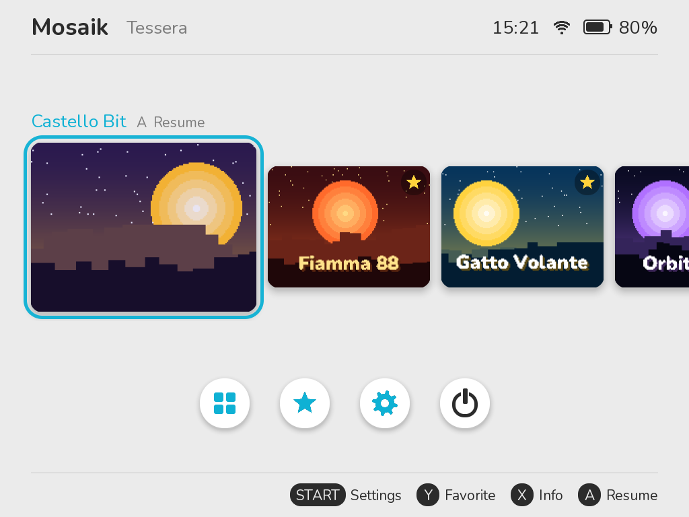
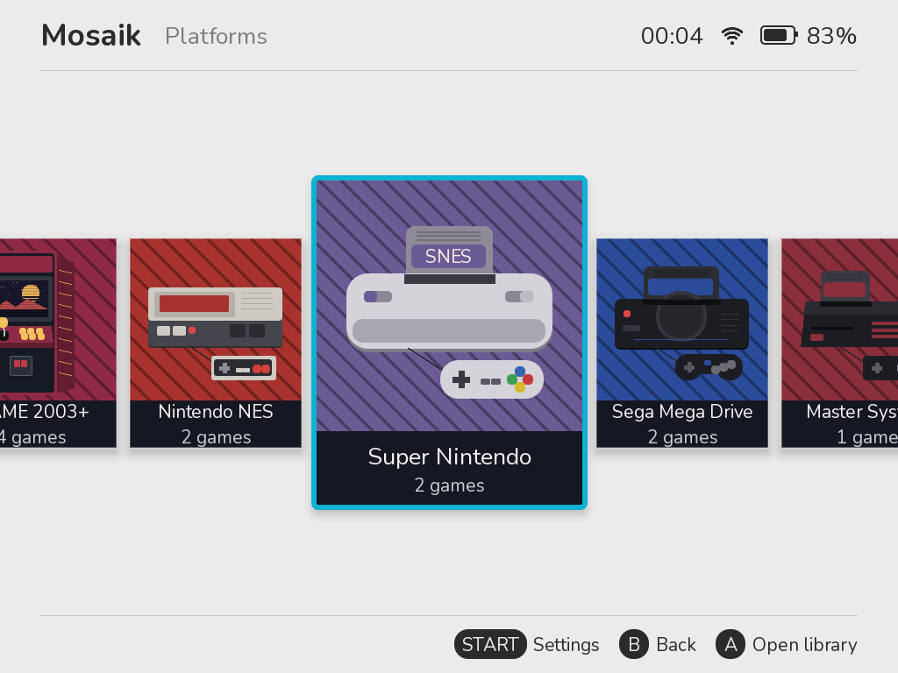
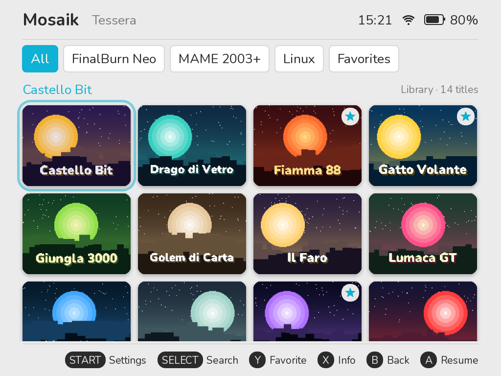
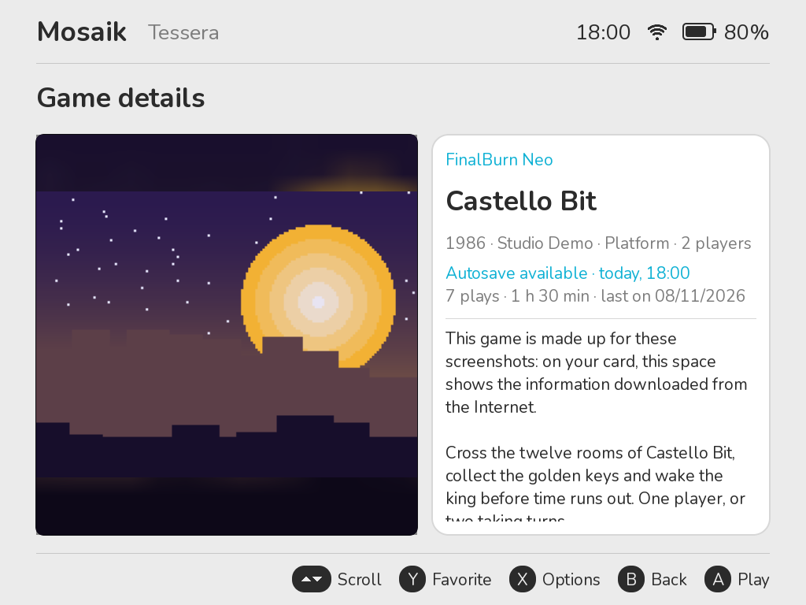
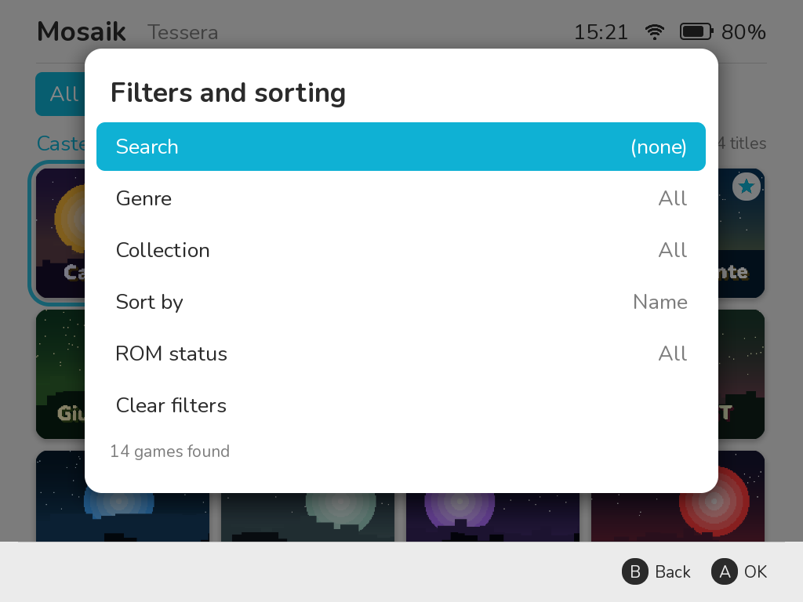
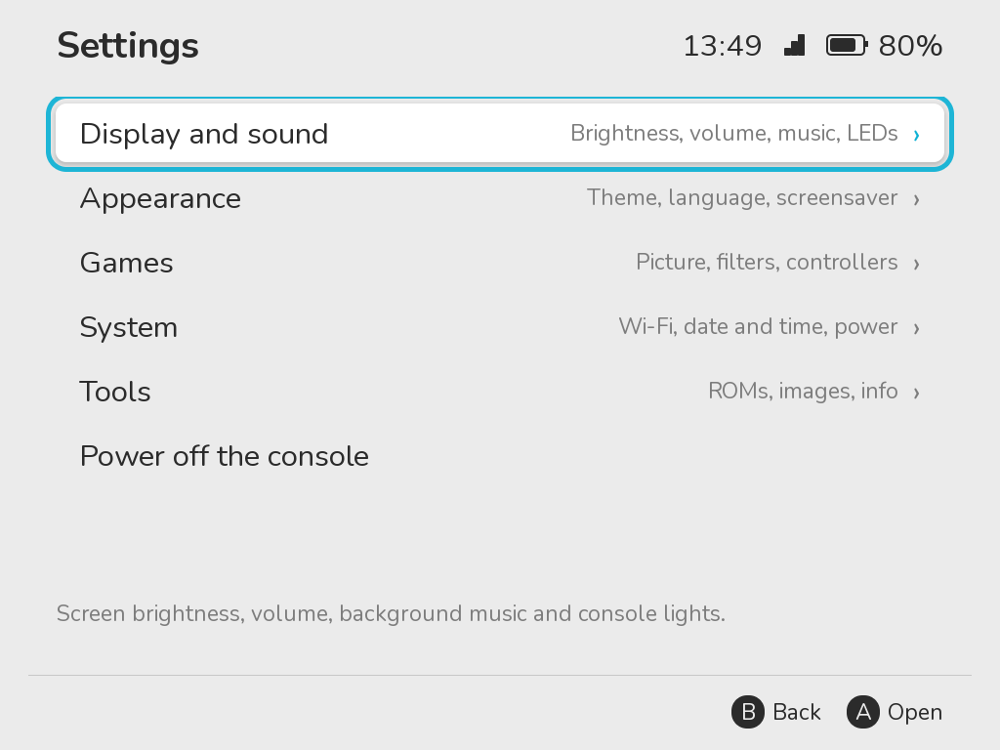
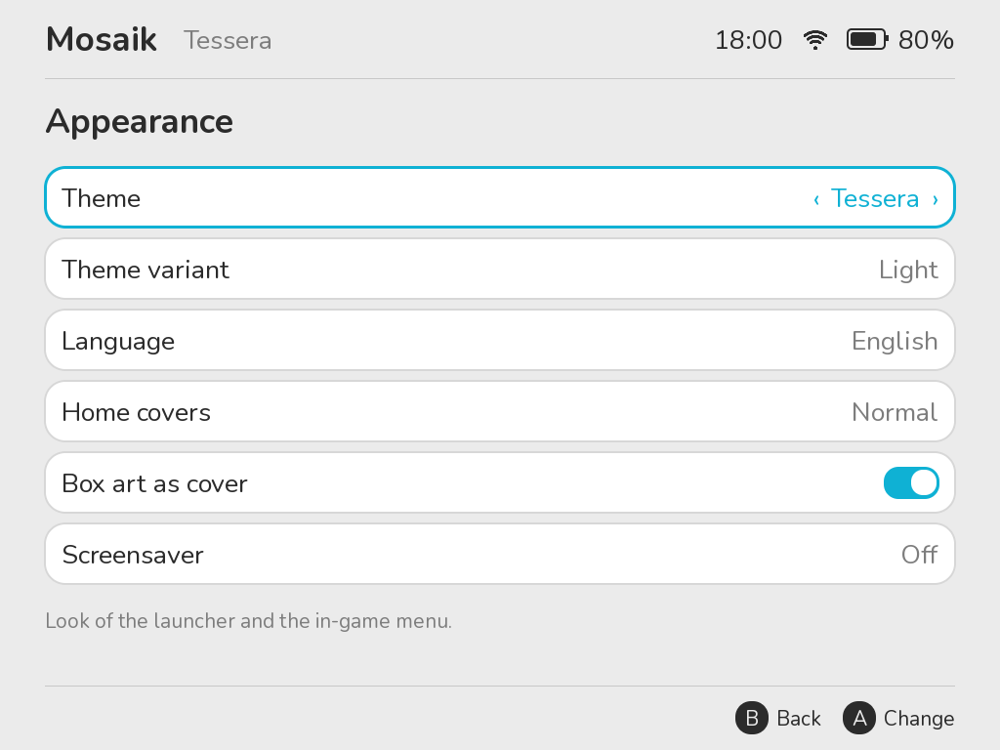
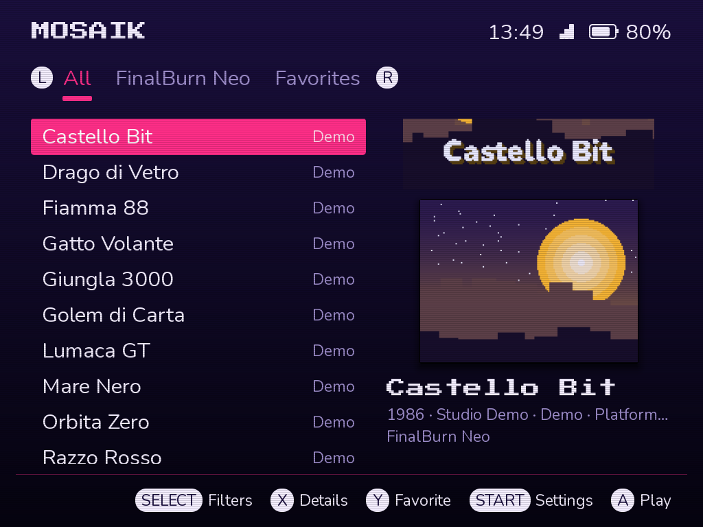
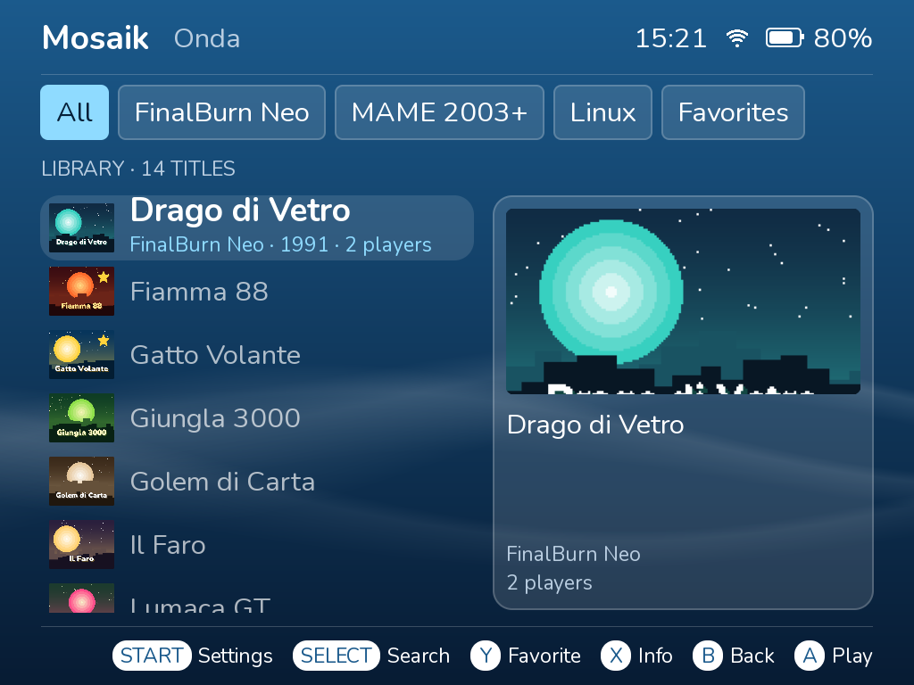

<p align="center">
  
</p>

<h3 align="center">All your games, in your pocket.</h3>

<p align="center">
  A gaming system for <b>TrimUI Smart Pro</b> and <b>Brick Pro</b>: arcade, consoles and Linux games.<br>
  It runs from the microSD and leaves the console's internal storage alone.
</p>

<p align="center">
  <a href="https://github.com/diapolon/mosaik_cfw/releases">Download</a> ·
  <a href="#installation">Installation</a> ·
  <a href="#loading-games">Loading games</a> ·
  <a href="#controls">Controls</a> ·
  <a href="#troubleshooting">Troubleshooting</a> ·
  <a href="https://github.com/diapolon/mosaik_cfw/wiki">Wiki</a> ·
  <a href="README.it.md">Italiano</a>
</p>

<p align="center">
  
</p>

> **Status:** version 0.9. **Smart Pro and Brick Pro: tested.**

## What's inside

- **FinalBurn Neo and MAME 2003-Plus**: Neo Geo, CPS1, CPS2 and most of the arcade classics.
- **NES, Super Nintendo, Mega Drive, Master System, Game Gear, PC Engine, Game Boy, Game Boy Color, Game Boy Advance and Neo Geo Pocket**, with battery saves (also the clock of the Pokémon games) and zipped ROMs.
- **Covers and game information for consoles too**: box art, title, year, publisher, genre and players, found by the ROM itself.
- **Linux games**, with an in-game menu and sleep.
- **Boots in about 5 seconds**, sleep with the power button.
- **Built-in Wi-Fi** for covers, game history, time and updates.
- **Three themes with color variants**, languages, LEDs and video filters you can configure.
- **Signed updates** over Wi-Fi, with an attempt to return to the previous version if one fails.
- **CPU profile for each game**, and a notice on the home screen when an update is available.
- **Game diagnosis**: when a game can't start, it tells you what's missing and where to copy it.
- **Three save slots per game** with preview and date, plus an automatic save with a previous copy.

## The interface

<table>
  <tr>
    <td></td>
    <td></td>
  </tr>
  <tr>
    <td align="center">Platforms, to pick a category before the games</td>
    <td align="center">The library, as a grid of pictures in Tessera</td>
  </tr>
  <tr>
    <td></td>
    <td></td>
  </tr>
  <tr>
    <td align="center">Game details, with history and information</td>
    <td align="center">Search, genres, collections and sorting</td>
  </tr>
  <tr>
    <td></td>
    <td></td>
  </tr>
  <tr>
    <td align="center">Settings, grouped in sections</td>
    <td align="center">Theme, color variant and language</td>
  </tr>
  <tr>
    <td></td>
    <td></td>
  </tr>
  <tr>
    <td align="center">Cabinato theme: the numbered arcade menu</td>
    <td align="center">Onda theme: the library as a vertical list</td>
  </tr>
</table>

<sub>The games and covers in these pictures are made up, just to show the interface.</sub>

## Installation

You need a good-quality microSD card (4 GB to 256 GB) and [balenaEtcher](https://etcher.balena.io/).

1. **Download the image** for your model from [Releases](https://github.com/diapolon/mosaik_cfw/releases). There's no need to decompress them. **Check the file name: with the image of the other model the console won't start.** Nothing gets damaged: just write the right one.
2. **Write it to the microSD** with balenaEtcher. Everything on the card is erased. If your computer then asks to format part of the card, say no.
3. **Put the card in the console and turn it on.** On first boot the partition grows to fill the card, so startup takes a little longer.
4. **Open the settings with Start** to set the language (Appearance) and the date and time (System).

To go back to the original system, turn the console off and remove the card.

## Loading games

> **ROMs and BIOS files are not included.** Only use copies of games you have the right to use.

Turn the console off and connect the card to your computer. Everything is in the `Arcade` folder of the `MOSAIK` drive (`ARCADE` on cards installed before 0.9.6):

| Folder | What goes in it |
|---|---|
| `Roms/FBNEO` | ROMs for FinalBurn Neo (current FBNeo set), subfolders allowed |
| `Roms/MAME2003P` | ROMs for MAME 2003-Plus (0.78-plus set) |
| `Roms/NES`, `Roms/SNES`, `Roms/MD` | NES, Super Nintendo and Mega Drive games |
| `Roms/SMS`, `Roms/GG`, `Roms/PCE` | Master System, Game Gear and PC Engine (HuCard) games |
| `Roms/GB`, `Roms/GBC`, `Roms/GBA`, `Roms/NGP` | Game Boy, Game Boy Color, Game Boy Advance and Neo Geo Pocket games |
| `Bios` | `neogeo.zip` and other BIOS files |
| `Linux` | Linux games, one per folder |
| `Media` | Game images |
| `Music` | Background music (MP3, OGG, FLAC, WAV) |
| `Saves` | Saves |

Keep arcade ROMs as `.zip` and don't rename them. Console games can be zipped or not, one game per zip; the GBA doesn't need a BIOS. **Settings → Tools → Verify ROMs** checks that every zip contains the right files, and the game's details page (X) shows what's missing, including a BIOS.

For covers and information, connect to Wi-Fi and use **Settings → Tools → Download images**.

### Linux games

Create a folder in `Arcade/Linux` with the game, built for 64-bit ARM Linux, and a `launch.sh` file that starts it:

```
Arcade/Linux/MyGame/
    launch.sh      required: starts the game
    game.json      optional: title and options
    cover.png      optional: cover
```

```json
{
  "title": "My game",
  "year": "2024",
  "author": "Author",
  "env": { "VARIABLE_NAME": "value" },
  "keys": { "A": "SPACE", "START": "ENTER" }
}
```

`env` sets environment variables before the game starts. `keys` is for games that don't read controllers: each console button presses the given keyboard key.

## Controls

| Button | What it does |
|---|---|
| Power, short press | Asks whether to sleep, even during a game: confirm with A or by pressing power again. Press it once more to wake |
| Power, held | Asks whether to power off. During a game it saves and powers off |
| Volume + / − | Volume, with an on-screen bar even in games |
| A / B | Confirm / back |
| X | Game details |
| Y | Add to favorites |
| Start | Settings |
| Select | Filters and sorting (in the library) |
| L / R | Switch tabs in the library |
| Menu (arcade and console games) | Game menu: save and load state, aspect ratio, filter, controls, exit |
| Menu held 1 s (Linux games) | Menu over the paused game |

**Shortcuts in arcade and console games (hold Menu):**

| Combination | What it does |
|---|---|
| Menu + R / L | Save / load state |
| Menu + R2 | Fast forward |
| Menu + X | Screenshot |
| Menu + Up / Down | Volume |
| Menu + Left / Right | Brightness |

On the Brick Pro, HOME goes back to the launcher, the two bars below the screen save and load the game, and the FN switch turns on maximum performance. **Settings → Controls** has a button and stick test and lets you choose what HOME and the two bars do.

## Wi-Fi and updates

Open **Settings → System**: **Wi-Fi** turns it on and off, **Wi-Fi networks** shows the networks to connect to. On the on-screen keyboard, X switches between uppercase, lowercase and symbols.

To update, open **Settings → Updates → Update system** and press A to download. When the download has been checked, press A again to install. ROMs, saves and settings are left untouched. Every update is signed and checked before it is installed, and if a new system fails to start, the console tries to go back to the previous one by itself. This does not cover every failure: in the worst case, write the image to the card again.

**Settings → Updates → Update channel** switches between Stable and Development (test builds that may have problems). Going back to Stable applies from the next stable version.

## Troubleshooting

- **The console doesn't turn on with the card:** check that you wrote the image for your model (`smartpro` or `brickpro` in the file name). Without the card the original system starts as usual.
- **Black or red screen at startup:** hold the power button for 10-20 seconds, remove the card and look in `Arcade/Logs`.
- **A game won't start:** the console shows what's missing and where to copy it. You can also open the check yourself: on the game details page press X and choose **Game diagnosis**.
- **A game misbehaves after changing its options:** on its details page press X and choose **Reset game**. Your ROM stays, and save states are kept unless you choose otherwise.
- **Neo Geo games won't start:** they need `neogeo.zip` in `Arcade/Bios`.
- **A game is slow or the audio crackles:** try the Performance profile in Settings → Games. Some 3D arcade games are too heavy or aren't supported.
- **Damaged files after copying:** cheap cards and readers can damage files without reporting errors. Try another reader or card.
- **Need more detail:** logs are off by default. Turn them on in **Settings → Updates → Diagnostic log**, restart the console, reproduce the problem and check `Arcade/Logs`.

## Building

The build uses Docker and needs components extracted from the official TrimUI firmware, which are not in this repository. See [`m2/README.md`](m2/README.md) (in Italian).

## License

The code written for Mosaik is under the [GNU LGPL v3](COPYING.LESSER). It does not cover third-party components, which keep their own licenses: see [`licenses/THIRD-PARTY.md`](licenses/THIRD-PARTY.md), which also links the emulator sources.

FinalBurn Neo, MAME 2003-Plus, Genesis Plus GX and Snes9x are for non-commercial use only, so **Mosaik must not be sold**, alone or preinstalled. The system images also contain components taken from the official TrimUI firmware, which belong to their respective owners. The source code of the GPL programs built for the images (BusyBox, dosfstools) is attached to each [release](https://github.com/diapolon/mosaik_cfw/releases), together with the source of the GPL and MPL emulators (FCEUmm, Gambatte, mGBA, Beetle PCE Fast, Beetle NeoPop) in the releases that include them.

Independent project, not affiliated with TrimUI.
